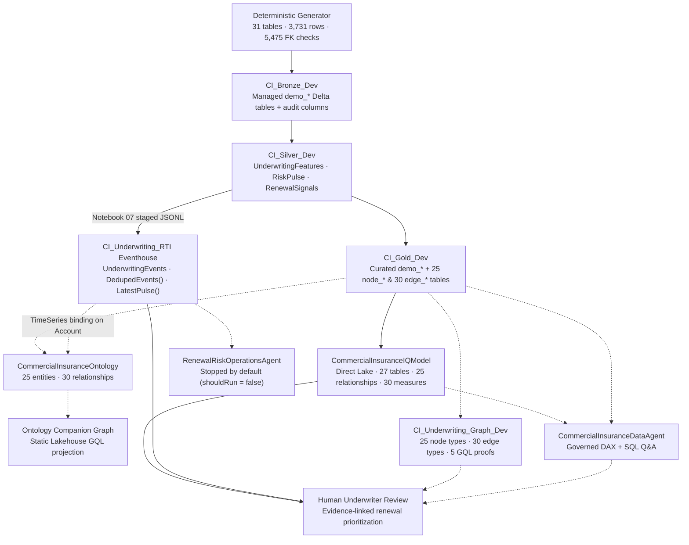

# Fabric IQ Commercial Insurance POC - Current Lab Design

**Scenario:** *Asterion Global Commercial* - a fictional global commercial insurer  
**Purpose:** Business use case, solution architecture, and current lab scope  
**Updated:** 2026-10-20  
**Execution guide:** follow [the lab instructions](LAB.md)  
**Presenter guide:** follow [the detailed presenter handbook](PRESENTER_GUIDE.md)  
**Customer deck:** open [the 15-slide customer presentation](docs/customer-demo/Fabric-IQ-Commercial-Insurance-Customer-Demo.pptx) (also synced to [Presentation.pptx](Presentation.pptx))

## Business Use Case

Asterion underwrites multinational commercial-property programs. Renewal evidence is
distributed across accounts, policies, locations, exposure valuations, catastrophe
models, claims, engineering recommendations, local policies, and broker submissions.
The lab connects those records around a governed account and location identity so an
underwriter can explain what changed before renewal.

### The Business Problem

Traditional renewal packs summarize premium and losses but often obscure the path from
a material change back to its evidence. A CAT model update, reserve development,
exposure growth, an open engineering recommendation, or missing submission evidence may
each alter the review priority. Reviewing each source independently makes it difficult
to answer:

> Which near-term renewals changed materially, why did their priority change, and what
> evidence should a human underwriter inspect?

The POC supplies one deterministic answer for the hero account `A001`. It does not
predict loss, recommend price, bind coverage, or automate an underwriting decision.

### Who Uses the Results

| Audience | Business question | Decision supported |
|---|---|---|
| Underwriters | Which renewals require review first, and why? | Prioritize a human renewal review. |
| CAT and portfolio teams | Where are modeled loss and concentration changing? | Inspect accumulations and model evidence. |
| Claims teams | Which claim or reserve developments affect a renewal? | Reconcile current and prior valuations. |
| Risk engineering | Which critical recommendations remain open? | Verify remediation evidence. |
| Multinational program teams | Which local policies do not meet program requirements? | Resolve wording, limit, or BI-period gaps. |
| Brokers and relationship teams | Which submission items remain assertions rather than verified evidence? | Request or validate supporting material. |

### A Renewal Journey

1. Account `A001` owns a multinational property program with five locations.
2. Matched 2025 and 2026 valuations show TIV, CAT AAL, and incurred-loss development.
3. Silver features normalize seven explainable components to the range `[0, 1]`.
4. The Renewal Risk Pulse applies documented weights that sum to 100 and produces 77.
5. Material-change rules preserve the source table and evidence key for each signal.
6. A staged Eventhouse update increases the pulse to 83, crossing the review threshold.
7. Semantic, ontology, and graph experiences let a reviewer inspect the same evidence
   through measures, business entities, and relationships.
8. Any pricing, binding, referral, or notification remains a human-governed action.

### What the Sample Demonstrates

The deterministic source contains 20 accounts, 100 locations, 40 policies, 80 claims,
matched valuation tables, engineering evidence, local-program requirements, and staged
underwriting events. The generated output contains **31 tables**, **3,731 rows**, and
passes **5,475** referential checks.

For `A001`, the current snapshot is:

| Metric | Reference value |
|---|---:|
| Total insured value | $1,140,000,000 |
| Prior total insured value | $1,000,000,000 |
| CAT AAL | $7,000,000 |
| Prior CAT AAL | $5,000,000 |
| Incurred loss | $7,000,000 |
| Prior incurred loss | $5,000,000 |
| Open critical recommendations | 2 |
| Days to renewal | 28 |
| Baseline pulse | 77 |
| Updated pulse | 83 |

**Success means** reproducing these values, tracing every signal to supplied evidence,
and proving the threshold crossing in Eventhouse. It does not mean production readiness,
security certification, actuarial approval, or autonomous action.

## Feature-to-Lab Roadmap

| Business need | Fabric contribution | Lab evidence | Scope | Lab section |
|---|---|---|---|---|
| Build a safe, repeatable portfolio | Lakehouse + deterministic PySpark generation | 31 tables, 3,731 rows, 5,475 checks | Core | [2: Medallion build](LAB.md#2-build-bronze-silver-and-gold-tables-module-0) |
| Separate raw, derived, and relationship-ready data | Bronze, Silver, and Gold Lakehouses | Ordered notebook completion and row checks | Core | [2: Medallion build](LAB.md#2-build-bronze-silver-and-gold-tables-module-0) |
| Explain renewal priority | Direct Lake `CommercialInsuranceIQModel` (27 tables, 25 relationships, 30 saved DAX measures) | `A001` TIV `$1.14B`, CAT AAL `$7M`, incurred `$7M`, critical recs `2`, pulse `77` | Core | [3: Semantic model](LAB.md#3-build-the-direct-lake-semantic-model-module-1) |
| Reconcile row-level underwriting evidence | SQL analytics endpoint queries | 6 underwriting evidence queries at documented grains | Optional | [4: SQL evidence path](LAB.md#4-validate-the-sql-evidence-path-module-2) |
| Detect a material change | Eventhouse `CI_Underwriting_RTI` + KQL | one `A001` crossing from `77` to `83` (`runId = 'deployed-001'`) | Core | [5: Eventhouse and KQL](LAB.md#5-configure-eventhouse-and-prove-the-pulse-crossing-module-7) |
| Navigate business relationships & live context | Fabric IQ `CommercialInsuranceOntology` | 25 entity types, 30 relationships, plus Eventhouse `UnderwritingEvents` time-series binding on `Account` | Optional preview | [6: Ontology](LAB.md#6-configure-the-ontology-and-time-series-binding-modules-3-4) |
| Investigate connected risk | Fabric Graph + GQL (`CI_Underwriting_Graph_Dev` & companion graph) | 5 GQL investigations returning `10 / 5 / 20 / 2 / 25` rows with `status = 00000` | Optional preview | [7: Graph analysis](LAB.md#7-build-and-query-the-graph-module-6) |
| Ask model-grounded business questions | Fabric `CommercialInsuranceDataAgent` | Grounded in `CommercialInsuranceIQModel` + `CI_Gold_Dev` with governed instructions and 4 few-shots | Optional AI | [8: Data Agent](LAB.md#8-configure-the-data-agent-module-8) |
| Monitor a supported threshold | `RenewalRiskOperationsAgent` | Configured against `CI_Underwriting_RTI` with `shouldRun = false` (stopped until human approval) | Optional preview | [9: Operations Agent](LAB.md#9-configure-the-operations-agent-module-9) |
| Ground external enterprise assistants | Microsoft Foundry / Copilot Studio via MCP | Consume published `CommercialInsuranceDataAgent` | Optional integration | [9.2: Agent grounding](LAB.md#92-external-agent-grounding-foundry-and-copilot-studio---module-10) |
| Automate pricing or binding | Not implemented | none | Excluded | Excluded |
| Use production/customer data | Not implemented | none | Excluded | Excluded |

## Architecture

### Data Contract

- The synthetic business date is `2026-09-14`; the matched prior date is `2025-09-14`.
- IDs are stable strings and primary keys are unique and non-null.
- Monetary source values use integer cents. Decimal presentation occurs only in queries
  and semantic measures.
- Feature components are clipped to `[0, 1]`; pulse weights total 100.
- Claims reconcile as `paid + outstanding = incurred`.
- Current and prior exposure totals reconcile to location TIV.
- Signals preserve source table, evidence key, threshold, and detection date.
- Demo tables use the `demo_` prefix; graph tables use `node_` and `edge_`.

### Security and Operational Boundaries

- No credentials are stored in notebooks, data, or deployment files.
- Deployment obtains short-lived tokens from Azure CLI and should use a least-privilege
  identity in automation.
- Use dedicated lab Lakehouses. Overwrite operations are intentional and scoped.
- Do not weaken OneLake security or production table settings to satisfy a preview
  binding restriction.
- Static graph and ontology bindings require refresh after source changes.
- Operations Agent rules and Teams actions remain stopped until an authorized reviewer
  approves the rule, identity, recipients, and rollback plan.

## Capability Scope

### Core

- deterministic data and artifact generation
- Bronze, Silver, and Gold notebook flow
- validation report and data hashes
- Direct Lake semantic definitions and DAX reference measures
- Eventhouse table/functions and KQL monitoring proof

### Optional

- SQL endpoint investigation queries
- ontology entity and relationship configuration
- Graph deployment and GQL investigations
- Data Agent model-grounded questions
- deployment automation through Fabric REST APIs

### Not Implemented

- production ingestion or change-data capture
- actuarial pricing or predictive loss modeling
- automatic bind/decline/referral decisions
- production identity design, RLS certification, or data classification
- outbound notifications without explicit authorization
- production SLAs, DR, monitoring, or cost model

## Acceptance Limits

Local validation proves deterministic source logic, referential integrity, generated
artifact consistency, and notebook syntax. It cannot prove Fabric Spark execution,
Direct Lake refresh behavior, DAX/KQL/GQL engine results, tenant permissions, preview
availability, or agent answer quality. Record those outcomes only after execution in
the target workspace.

## Primary References

- [Fabric IQ overview](https://learn.microsoft.com/fabric/iq/overview)
- [Ontology overview](https://learn.microsoft.com/fabric/iq/ontology/overview)
- [Ontology bindings](https://learn.microsoft.com/fabric/iq/ontology/how-to-bind-data)
- [Fabric Graph overview](https://learn.microsoft.com/fabric/graph/overview)
- [Fabric Data Agent](https://learn.microsoft.com/fabric/data-science/concept-data-agent)
- [Operations Agent](https://learn.microsoft.com/fabric/real-time-intelligence/operations-agent)
- [Direct Lake overview](https://learn.microsoft.com/fabric/fundamentals/direct-lake-overview)
- [Fabric REST API](https://learn.microsoft.com/rest/api/fabric/articles/)
